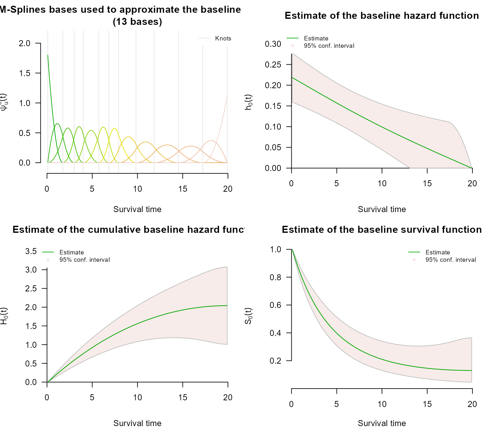
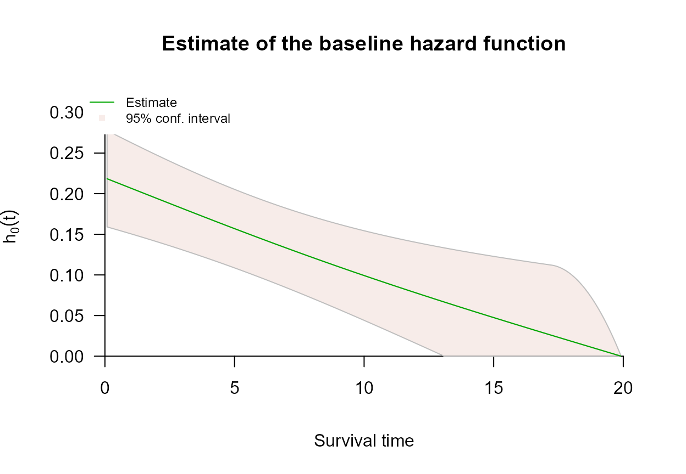
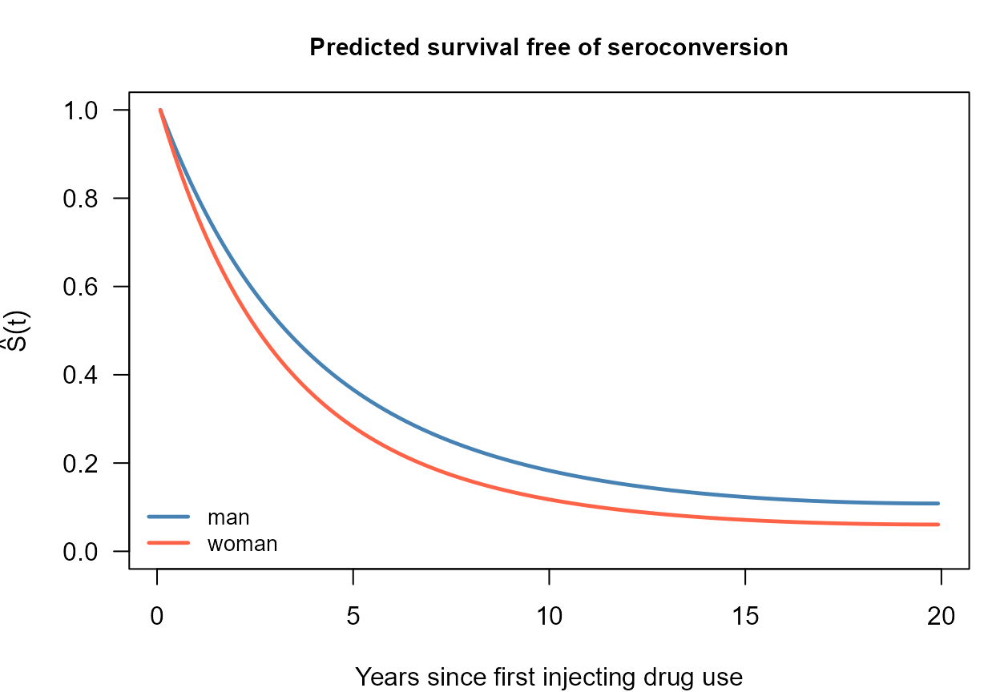

# Left Censoring with survivalMPL

## Overview

A survival time is *left censored* when the event is known to have
happened already by the time the subject is first examined, but not
when. All that is recorded is an upper bound $`t_R`$: the event occurred
somewhere in $`(0, t_R]`$. This arises whenever the outcome is detected
by inspection rather than observed as it happens - a tumour already
present at the first scan, seroconversion already complete at enrolment,
a milestone already reached at the first assessment.

The likelihood contribution is the distribution function rather than the
survivor function,

``` math
P(T \leq t_R) = 1 - S(t_R) = 1 - \exp\bigl\{-H_0(t_R)e^{\mathbf{x}^T\boldsymbol{\beta}}\bigr\},
```

which the partial likelihood cannot accommodate: it needs a risk set at
a known event time, and a left-censored subject supplies neither.
Because
[`coxph_mpl()`](https://CRAN.R-project.org/package=survivalMPL/reference/coxph_mpl.md)
estimates $`H_0`$ explicitly, left-censored observations enter the
likelihood directly, and may be mixed freely with exact events and
right- and interval-censored observations in the same fit.

## Encoding left-censored observations

Left censoring uses the `type = "interval2"` response, with `NA` in
place of the unknown lower endpoint:

\
[`library`](https://rdrr.io/r/base/library.html)`(`[`survivalMPL`](https://CRAN.R-project.org/package=survivalMPL)`)`\
`#> Loading required package: survival`\
`#> Loading required package: MASS`\
[`library`](https://rdrr.io/r/base/library.html)`(`[`survival`](https://github.com/therneau/survival)`)`\
\
[`Surv`](https://rdrr.io/pkg/survival/man/Surv.html)`(`[`c`](https://rdrr.io/r/base/c.html)`(``NA``, ``2``, ``3``, ``5``)``, `[`c`](https://rdrr.io/r/base/c.html)`(``7``, ``4``, ``NA``, ``5``)``, type ``=`` ``"interval2"``)`\
`#> [1] 7-     [2, 4] 3+     5`

The four observations above are, in order: left censored at 7 (`7-`),
interval censored on $`(2, 4]`$, right censored at 3 (`3+`), and an
exact event at 5. [`Surv()`](https://rdrr.io/pkg/survival/man/Surv.html)
records the distinction in its status code, and
[`coxph_mpl()`](https://CRAN.R-project.org/package=survivalMPL/reference/coxph_mpl.md)
dispatches on that code:

\
`s`` ``<-`` `[`Surv`](https://rdrr.io/pkg/survival/man/Surv.html)`(`[`c`](https://rdrr.io/r/base/c.html)`(``NA``, ``2``, ``3``, ``5``)``, `[`c`](https://rdrr.io/r/base/c.html)`(``7``, ``4``, ``NA``, ``5``)``, type ``=`` ``"interval2"``)`\
[`data.frame`](https://rdrr.io/r/base/data.frame.html)`(``status ``=`` ``s``[``, ``3``]``,`\
`           meaning ``=`` `[`c`](https://rdrr.io/r/base/c.html)`(``"left censored"``, ``"interval censored"``,`\
`                       ``"right censored"``, ``"exact event"``)``)`\
`#>   status           meaning`\
`#> 1      2     left censored`\
`#> 2      3 interval censored`\
`#> 3      0    right censored`\
`#> 4      1       exact event`

Note that `NA` here is *information*, not missingness: these rows are
kept, not dropped by `na.action`.

Recording a left-censored observation as `NA` and recording it as the
interval $`(0, t_R]`$ describe the same event, since $`S(0) = 1`$ makes
$`1 - S(t_R)`$ and $`S(0) - S(t_R)`$ identical. Both encodings are
accepted; the `NA` form is the one that states the intent.

------------------------------------------------------------------------

## Example: HIV seroconversion in people who inject drugs

The example uses `drugusers` from the CRAN package **icpack** (Gómez et
al. 2000): 940 people who inject drugs, attending a hospital
detoxification unit in Barcelona, followed for HIV seroconversion. The
data are not bundled with survivalMPL, so the code below runs only when
icpack is installed.

Time is measured from the start of injecting drug use, and HIV status is
only known at test visits. That gives all four observation types:

- the first test was already positive: seroconversion happened somewhere
  in $`(0, t_R]`$ - **left censored**;
- a negative test followed by a positive one: seroconversion lies
  between the two - **interval censored**;
- the last test was negative: **right censored**;
- the two tests coincide: an **exact** time.

In `drugusers`, `left` is the last negative test (0 if the first test
was already positive) and `right` the first positive test (`Inf` if the
last test was negative), both in months. Converting to years and
replacing the open bounds by `NA` gives the encoding described above:

\
[`data`](https://rdrr.io/r/utils/data.html)`(``drugusers``, package ``=`` ``"icpack"``)`\
\
`ivdu`` ``<-`` `[`data.frame`](https://rdrr.io/r/base/data.frame.html)`(`\
`  t_L         ``=`` `[`ifelse`](https://rdrr.io/r/base/ifelse.html)`(``drugusers``$``left`` ``==`` ``0``, ``NA``, ``drugusers``$``left`` ``/`` ``12``)``,`\
`  t_R         ``=`` `[`ifelse`](https://rdrr.io/r/base/ifelse.html)`(`[`is.finite`](https://rdrr.io/r/base/is.finite.html)`(``drugusers``$``right``)``, ``drugusers``$``right`` ``/`` ``12``, ``NA``)``,`\
`  Female      ``=`` `[`as.integer`](https://rdrr.io/r/base/integer.html)`(``drugusers``$``gender`` ``==`` ``"female"``)``,`\
`  Age_centred ``=`` ``(``drugusers``$``age`` ``-`` `[`mean`](https://rdrr.io/r/base/mean.html)`(``drugusers``$``age``)``)`` ``/`` ``10``,`\
`  period      ``=`` `[`relevel`](https://rdrr.io/r/stats/relevel.html)`(`[`factor`](https://rdrr.io/r/base/factor.html)`(`[`as.character`](https://rdrr.io/r/base/character.html)`(``drugusers``$``period``)``)``, ``"1972-1980"``)`\
`)`\
\
[`table`](https://rdrr.io/r/base/table.html)`(``status ``=`` `[`Surv`](https://rdrr.io/pkg/survival/man/Surv.html)`(``ivdu``$``t_L``, ``ivdu``$``t_R``, type ``=`` ``"interval2"``)``[``, ``3``]``)`\
`#> status`\
`#>   0   1   2   3 `\
`#> 343   2 530  65`

Status `2` marks the 530 left-censored subjects, more than half the
sample, status `3` the 65 interval-censored ones, status `0` the 343
right-censored ones and status `1` the 2 exact times. `Age_centred` is
age at the start of drug use in decades, centred at the sample mean, and
`period` is the period in which drug use began, with 1972-1980 as the
reference.

### Model fit

$`H_0`$ is evaluated at $`t_R`$ for every left-censored subject, so the
shape of the baseline matters more here than it does for right-censored
data. That argues for a smooth basis, `basis = "msplines"`. Everything
else, including the automatic selection of the smoothing value, is left
at its default; `tol` is loosened to `1e-05`, as in the other articles -
see **Control Parameters**.

\
`fit_hiv`` ``<-`` `[`coxph_mpl`](https://CRAN.R-project.org/package=survivalMPL/reference/coxph_mpl.md)`(`\
`  `[`Surv`](https://rdrr.io/pkg/survival/man/Surv.html)`(``t_L``, ``t_R``, type ``=`` ``"interval2"``)`` ``~`` ``Female`` ``+`` ``Age_centred`` ``+`` ``period``,`\
`  data  ``=`` ``ivdu``,`\
`  basis ``=`` ``"msplines"``,`\
`  tol   ``=`` ``1e-05`\
`)`\
\
[`summary`](https://rdrr.io/r/base/summary.html)`(``fit_hiv``)`\
`#> `\
`#> coxph_mpl(formula = Surv(t_L, t_R, type = "interval2") ~ Female + `\
`#>     Age_centred + period, data = ivdu, basis = "msplines", tol = 1e-05)`\
`#> `\
`#> -----`\
`#> `\
`#> Cox Proportional Hazards Model Fit Using MPL `\
`#> `\
`#> `\
`#> Penalized log-likelihood  :  -754.9098`\
`#> Estimated smoothing value :  1760760`\
`#> Convergence               :  Yes (10 + 3148 iter.) `\
`#> `\
`#> Data             : ivdu`\
`#> Number of obs.   : 940`\
`#> Number of events :   2 ( 0.212766%)`\
`#> Number of cens.  : 938 (99.787234%)`\
`#> `\
`#> Regression parameters : Surv(t_L, t_R, type = "interval2") ~ Female + Age_centred + period`\
`#>                  Estimate Std. Error z-value Pr(>|z|)  `\
`#> Female           0.231753   0.115438  2.0076  0.04469 *`\
`#> Age_centred     -0.031769   0.103845 -0.3059  0.75966  `\
`#> period1981-1985  0.081383   0.122707  0.6632  0.50718  `\
`#> period1986-1991 -0.249897   0.145466 -1.7179  0.08581 .`\
`#> period1992-1997 -0.374042   0.286460 -1.3057  0.19164  `\
`#> ---`\
`#> Signif. codes:  0 '***' 0.001 '**' 0.01 '*' 0.05 '.' 0.1 ' ' 1`\
`#> `\
`#> Baseline hasard parameters approximated using M-Splines :`\
`#>  (2 (min/max) + 8 quantile knots + 2 equally spaced knots + 3 (order) - 2 = 13 parameters) `\
`#>            1            2            3            4            5            6 `\
`#> 1.213169e-01 2.020793e-01 2.473852e-01 2.324436e-01 2.026398e-01 1.848422e-01 `\
`#>            7            8            9           10           11           12 `\
`#> 1.762641e-01 1.859211e-01 1.986088e-01 1.615379e-01 1.045321e-01 2.307903e-02 `\
`#>           13 `\
`#> 1.039732e-10 `\
`#> `\
`#> -----`

The summary counts only the 2 exact times as “events”; the other 938
subjects enter the likelihood through censored contributions. Hazard
ratios with 95% confidence intervals are easier to read:

\
`est`` ``<-`` `[`coef`](https://rdrr.io/r/stats/coef.html)`(``fit_hiv``)`\
`se``  ``<-`` ``fit_hiv``$``se``$``Beta``$``M2HM2`\
\
[`round`](https://rdrr.io/r/base/Round.html)`(`[`cbind`](https://rdrr.io/r/base/cbind.html)`(``HR    ``=`` `[`exp`](https://rdrr.io/r/base/Log.html)`(``est``)``,`\
`            lower ``=`` `[`exp`](https://rdrr.io/r/base/Log.html)`(``est`` ``-`` ``1.96`` ``*`` ``se``)``,`\
`            upper ``=`` `[`exp`](https://rdrr.io/r/base/Log.html)`(``est`` ``+`` ``1.96`` ``*`` ``se``)``)``, ``2``)`\
`#>                   HR lower upper`\
`#> Female          1.26  1.02  1.56`\
`#> Age_centred     0.97  0.79  1.19`\
`#> period1981-1985 1.08  0.86  1.38`\
`#> period1986-1991 0.78  0.59  1.03`\
`#> period1992-1997 0.69  0.40  1.19`

Women seroconvert faster than men at the same age and period, by about a
quarter. The hazard is lower for those who began injecting later, 22%
lower in 1986-1991 and 31% lower in 1992-1997 than in 1972-1980, though
only the first of these comes close to significance, and the confidence
intervals are wide. Age at initiation has no detectable effect. Real
data come with no known truth to compare against, so the check is
robustness: the coefficients barely move when the basis is changed.

\
`fit_unif`` ``<-`` `[`coxph_mpl`](https://CRAN.R-project.org/package=survivalMPL/reference/coxph_mpl.md)`(`\
`  `[`Surv`](https://rdrr.io/pkg/survival/man/Surv.html)`(``t_L``, ``t_R``, type ``=`` ``"interval2"``)`` ``~`` ``Female`` ``+`` ``Age_centred`` ``+`` ``period``,`\
`  data  ``=`` ``ivdu``,`\
`  basis ``=`` ``"uniform"``,`\
`  tol   ``=`` ``1e-05`\
`)`\
\
[`round`](https://rdrr.io/r/base/Round.html)`(`[`cbind`](https://rdrr.io/r/base/cbind.html)`(``msplines ``=`` `[`coef`](https://rdrr.io/r/stats/coef.html)`(``fit_hiv``)``, uniform ``=`` `[`coef`](https://rdrr.io/r/stats/coef.html)`(``fit_unif``)``)``, ``3``)`\
`#>                 msplines uniform`\
`#> Female             0.232   0.233`\
`#> Age_centred       -0.032  -0.038`\
`#> period1981-1985    0.081   0.057`\
`#> period1986-1991   -0.250  -0.290`\
`#> period1992-1997   -0.374  -0.413`

### Baseline hazard and survival

\
[`par`](https://rdrr.io/r/graphics/par.html)`(``mfrow ``=`` `[`c`](https://rdrr.io/r/base/c.html)`(``2``, ``2``)``, mar ``=`` `[`c`](https://rdrr.io/r/base/c.html)`(``4``, ``4``, ``3``, ``1``)``)`\
[`plot`](https://rdrr.io/r/graphics/plot.default.html)`(``fit_hiv``, ask ``=`` ``FALSE``, cex.main ``=`` ``0.8``)`



The four panels are the M-spline basis functions, then the estimated
baseline hazard, cumulative hazard and survival. The hazard panel is the
one to read first: the risk of seroconversion is highest soon after drug
use begins and declines with its duration. The estimate is close to a
straight line because the automatic smoothing value is very large; the
confidence band is wide, and honestly so, since a left-censored subject
only says that the event happened at some point before $`t_R`$.

\
[`plot`](https://rdrr.io/r/graphics/plot.default.html)`(``fit_hiv``, which ``=`` ``2``, ask ``=`` ``FALSE``, cex.main ``=`` ``0.9``)`



### Predicted survival

Because $`H_0`$ is estimated, survival can be predicted for a named
covariate profile rather than only compared between profiles. Here are a
woman and a man who began injecting in the same period at the same age:

\
`i_f`` ``<-`` `[`which`](https://rdrr.io/r/base/which.html)`(``ivdu``$``Female`` ``==`` ``1`` ``&`` ``ivdu``$``period`` ``==`` ``"1981-1985"`` ``&`\
`             ``drugusers``$``age`` ``==`` ``19``)``[``1``]`\
`i_m`` ``<-`` `[`which`](https://rdrr.io/r/base/which.html)`(``ivdu``$``Female`` ``==`` ``0`` ``&`` ``ivdu``$``period`` ``==`` ``"1981-1985"`` ``&`\
`             ``drugusers``$``age`` ``==`` ``19``)``[``1``]`\
\
`p_f`` ``<-`` `[`predict`](https://rdrr.io/r/stats/predict.html)`(``fit_hiv``, type ``=`` ``"survival"``, i ``=`` ``i_f``)`\
`p_m`` ``<-`` `[`predict`](https://rdrr.io/r/stats/predict.html)`(``fit_hiv``, type ``=`` ``"survival"``, i ``=`` ``i_m``)`\
\
[`par`](https://rdrr.io/r/graphics/par.html)`(``mar ``=`` `[`c`](https://rdrr.io/r/base/c.html)`(``4``, ``4.2``, ``3``, ``1``)``)`\
[`plot`](https://rdrr.io/r/graphics/plot.default.html)`(``p_m``$``time``, ``p_m``$``survival``, type ``=`` ``"l"``, col ``=`` ``"steelblue"``, lwd ``=`` ``2.4``,`\
`     ylim ``=`` `[`c`](https://rdrr.io/r/base/c.html)`(``0``, ``1``)``, xlab ``=`` ``"Years since first injecting drug use"``,`\
`     ylab ``=`` `[`expression`](https://rdrr.io/r/base/expression.html)`(`[`hat`](https://rdrr.io/r/stats/influence.measures.html)`(``S``)``(``t``)``)``, las ``=`` ``1``,`\
`     main ``=`` ``"Predicted survival free of seroconversion"``, cex.main ``=`` ``0.95``)`\
[`lines`](https://rdrr.io/r/graphics/lines.html)`(``p_f``$``time``, ``p_f``$``survival``, col ``=`` ``"tomato"``, lwd ``=`` ``2.4``)`\
[`legend`](https://rdrr.io/r/graphics/legend.html)`(``"bottomleft"``, legend ``=`` `[`c`](https://rdrr.io/r/base/c.html)`(``"man"``, ``"woman"``)``,`\
`       col ``=`` `[`c`](https://rdrr.io/r/base/c.html)`(``"steelblue"``, ``"tomato"``)``, lwd ``=`` ``2.4``, bty ``=`` ``"n"``, cex ``=`` ``0.85``)`



------------------------------------------------------------------------

## Next steps

- **Interval Censoring** covers the general partly interval-censored
  case, of which left censoring is the boundary instance, and uses a
  dataset containing all four observation types at once.
- **Right Censoring** covers the standard scheme and the
  `Surv(time, status)` response.
- **Control Parameters** explains `n.knots`, `basis` and `smooth`, the
  settings that decide how much structure the baseline hazard is allowed
  to have.
- **Basis Functions for the Baseline Hazard** explains the choice of
  $`\psi_u`$; because $`H_0(t_R)`$ enters the left-censored likelihood
  directly, that choice matters more here than for right-censored data
  alone.

## References

Gómez, G., M. L. Calle, J. M. Egea, and R. Muga. 2000. “Risk of HIV
Infection as a Function of the Duration of Intravenous Drug Use: A
Non-Parametric Bayesian Approach.” *Statistics in Medicine* 19: 2641–56.
